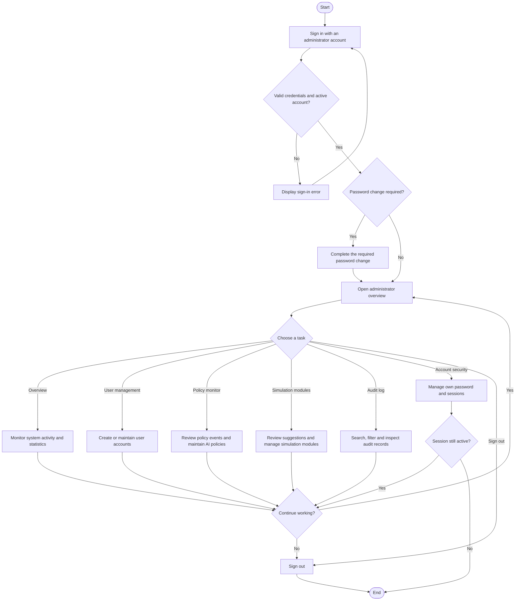

# Administrator flowchart — HelpDesk AI

This chart shows the administrator's general navigation and work cycle. Operations such as adding users or generating drafts are grouped under their main features.

## What each feature covers

| Feature | General activity |
| --- | --- |
| Overview | Review available account, policy and simulation activity summaries. |
| User management | Create accounts, update account details and roles, reset passwords, activate/deactivate accounts or delete accounts within system safeguards. |
| Policy monitor | Review policy events, configure policy messages and scope/safety rules, and reset session restrictions when appropriate. |
| Simulation modules | Review prompt suggestions; create or resume drafts; edit and arrange steps; test modules; save, enable, disable or delete modules; and inspect revision history. |
| Audit log | Browse and filter recorded administrator requests, then expand their recorded details. This feature is read-only. |
| Account security | Change the administrator's own password or sign out of all devices. Signing out everywhere ends the current session. |

## Flow rules

- The administrator role is a precondition. A valid regular-user account opens the user workspace instead of this flow.
- An unsuccessful password update leaves the administrator on the password-change screen until it succeeds.
- Failed operations display an error and allow correction or retry; they do not count as successfully completed changes. Returning to the overview is a navigation choice, not an automatic redirect after every operation.
- Draft edits autosave separately from saving or publishing a module. Publishing a terminal module requires a valid completed test for its exact definition. Windows administrator testing does not create a learner completion record.
- End an active Windows test before leaving its workspace.
- Audit entries describe recorded requests and outcomes; missing outcomes are not assumed to be failures.

Related: [Generalized use cases](GENERALIZED_USE_CASES.md) and [User flowchart](USER_FLOWCHART.md).
