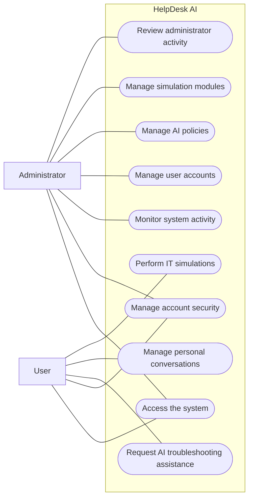

# Generalized use cases — HelpDesk AI

These use cases describe the main goals supported by the implemented system. Individual buttons and operations are grouped under their parent feature.

## Actors

| Actor | Description |
| --- | --- |
| Administrator | Maintains accounts, AI policies and simulation modules, and reviews system activity. |
| User | Receives IT troubleshooting assistance, manages personal conversations and practices IT tasks through simulations. |

## Shared use cases

| ID | Use case | General description |
| --- | --- | --- |
| UC-01 | Access the system | Sign in with an administrator-provided account and sign out when finished. The system opens the workspace permitted for the account's role. |
| UC-02 | Manage account security | Change the account password and sign out of all devices. Complete a required password change before using protected features. |

## Administrator use cases

The administrator can perform UC-01 and UC-02, together with the following administrative features.

| ID | Generalized use case | Goal | Included functionality |
| --- | --- | --- | --- |
| AD-01 | Monitor system activity | Understand current account, policy and simulation activity. | View the administrator overview, activity summaries and available simulation statistics. |
| AD-02 | Manage user accounts | Control who can access the system and what role they have. | Create accounts, update account information and roles, reset passwords, activate/deactivate accounts and delete accounts within system safeguards. |
| AD-03 | Manage AI policies | Maintain the rules and responses used to keep assistance within the supported scope. | Configure scope and safety rules and policy messages, review policy events and reset session restrictions when appropriate. |
| AD-04 | Manage simulation modules | Prepare and maintain the simulations available to users. | Review prompt suggestions; generate, recover and edit drafts; arrange steps; test simulations; save modules; enable/disable modules; review revisions; and delete modules. |
| AD-05 | Review administrator activity | Investigate recorded administrative actions and their outcomes. | Search and filter audit records, browse history and expand recorded request details. Audit records are read-only in the interface. |

## User use cases

The user can perform UC-01 and UC-02, together with the following learning and troubleshooting features.

| ID | Generalized use case | Goal | Included functionality |
| --- | --- | --- | --- |
| US-01 | Request AI troubleshooting assistance | Receive guidance for an IT-related problem. | Describe an issue, answer clarifying questions, continue the conversation and use available suggested questions. Requests and responses are subject to policy and safety checks. |
| US-02 | Manage personal conversations | Organize and return to previous assistance. | Start and reopen conversations, search saved history, mark favorites, use supported prompt editing and delete personal chat data. |
| US-03 | Perform IT simulations | Practice IT support tasks in a guided environment. | Access available modules, follow walkthroughs and instructions, practice terminal actions or Windows desktop tasks, review available progress and complete or end a simulation. |

## Generalized use-case overview

A formal UML version of the same actor/use-case associations is provided in `GENERALIZED_USE_CASES.puml`.

## Scope and interpretation

- Authentication and the correct account role are preconditions for protected use cases; login is not repeated as a separate included step under every feature.
- Administrator and User are separate roles in the current interface. The diagram does not imply that administrators inherit all user-workspace features. Administrators test simulations through module management.
- Accounts are created by administrators; public self-registration is not an implemented use case.
- A user manages their own conversations and account security. This does not grant access to another user's data or administrative controls.
- Simulation completion represents the evidence available for that simulation: verified fictional terminal actions or self-reported desktop completion. It does not imply independent real-world task assessment.
- AI providers, PostgreSQL, AWS and Guacamole support these goals internally. They are omitted from this generalized actor-feature overview to keep the focus on Administrator and User.

## Implementation references

- Administrator navigation and features: `client/src/pages/admin/AdminPage.jsx`.
- Administrator audit-log interface: `client/src/pages/admin/AuditLogPage.jsx`.
- User chat, history, account controls and simulation entry points: `client/src/pages/users/DashboardPage.jsx`.
- Windows simulation interface: `client/src/pages/users/Modules/WindowsOsSimulation.jsx`.
- Authentication and role-based navigation: `client/src/App.jsx` and `server/src/routes/auth.routes.js`.

## Role flowcharts

- [Administrator flowchart](ADMIN_FLOWCHART.md)
- [User flowchart](USER_FLOWCHART.md)
