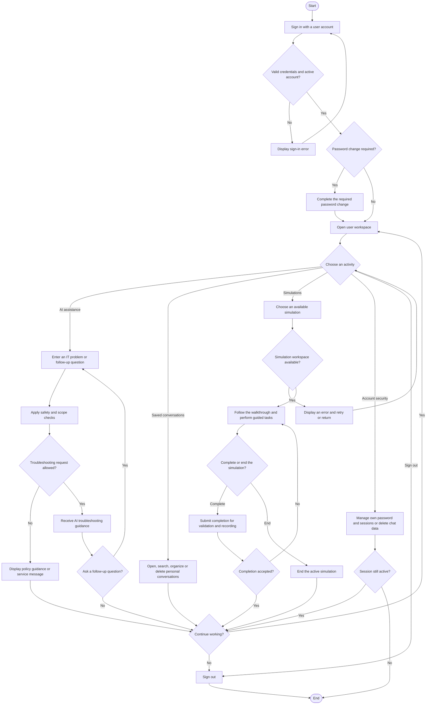

# User flowchart — HelpDesk AI

This chart shows the regular user's general troubleshooting, conversation-management and simulation workflow.

## What each activity covers

| Activity | General activity |
| --- | --- |
| AI assistance | Describe an IT issue, respond to clarifying questions and continue troubleshooting through follow-up messages. |
| Saved conversations | Start or reopen conversations, search history, mark favorites, use supported prompt editing and delete personal conversations. |
| Simulations | Access available modules and practice the supported terminal or Windows desktop tasks. Follow instructions, review available progress, and complete or end the simulation. |
| Account security | Change the user's own password, delete personal chat data or sign out of all devices. Signing out everywhere ends the current session. |

## Flow rules

- The regular-user role is a precondition. A valid administrator account opens the administrator workspace instead of this flow. Accounts are supplied by an administrator; public registration is not part of the workflow.
- An unsuccessful password update leaves the user on the password-change screen until it succeeds.
- The AI branch is generalized. The implementation checks responses as well as requests; clarification, unsupported-topic guidance and safety/service messages may replace troubleshooting instructions. Users cannot bypass a cooldown simply by resubmitting the same request.
- A terminal workspace uses simulated server actions. A Windows workspace is prepared remotely before it becomes usable. The availability decision covers permissions, capacity, provisioning and connection failures.
- Terminal completion requires the server-issued attempt's required steps to be verified. Windows completion requires an associated live workspace and remains self-reported; the chart does not imply verification of actual OS changes.
- Ending a simulation is separate from recording completion. An expired or unusable workspace may need to be ended and restarted rather than returning to practice in the same attempt.
- Saved progress is retained where supported. A new Windows lab is a fresh environment; resuming saved guidance is not a promise to restore a terminated VM's disk state.
- Returning to the workspace represents navigation chosen by the user. The application may keep the current chat or simulation review open after a task.

Related: [Generalized use cases](GENERALIZED_USE_CASES.md) and [Administrator flowchart](ADMIN_FLOWCHART.md).
